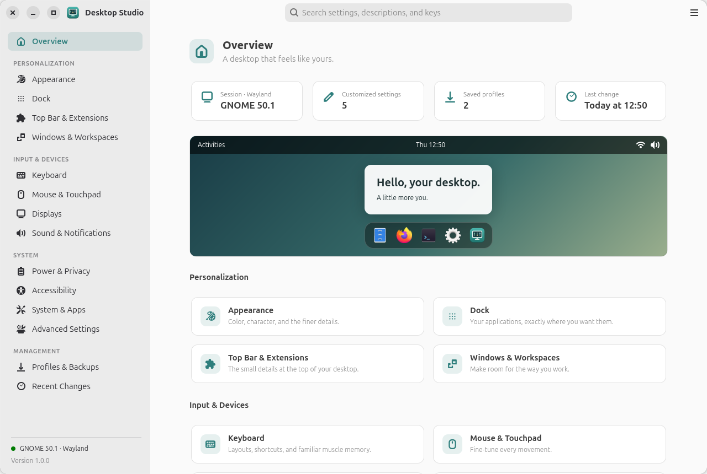

<h1 align="center">Desktop Studio</h1>

<p align="center">
  <strong>Every GNOME setting, in one careful place.<br>Change your desktop with confidence, and undo anything.</strong>
</p>

<p align="center">
  <a href="https://farvisun.github.io/nome-tweak/">Website</a> ·
  <a href="https://github.com/farvisun/nome-tweak/releases/latest">Download</a> ·
  <a href="#install">Install</a> ·
  <a href="#faq">FAQ</a>
</p>

<p align="center">
  <a href="https://github.com/farvisun/nome-tweak/releases/latest"></a>
  <a href="https://github.com/farvisun/nome-tweak/actions/workflows/ci.yml"></a>
  
  
</p>

<p align="center">
  
</p>

Desktop Studio is a native app for Ubuntu and GNOME that brings appearance, dock, keyboard, windows, displays and every other setting together. It only shows what your system really supports, tells you exactly what each change does, and keeps a way back for every edit. Opening it never changes anything.

## Features

- **Search everything.** Find any setting by name or description with **Ctrl + F**, including every hidden key your system has.
- **Appearance and dock.** Accent colour, themes, cursors, fonts and wallpaper with a live desktop preview, plus every Ubuntu Dock option.
- **Keyboard.** Layouts (including Persian), a shortcut recorder that warns about conflicts, custom command shortcuts, and Mac-style key mapping with Toshy.
- **Windows, mouse and displays.** Title-bar buttons, tiling, workspaces, mouse and touchpad behaviour, and display arrangement with GNOME's own Keep / Revert safety timer.
- **Profiles and backups.** Save your whole setup, compare it before applying, and restore the configuration you started with.
- **Undo with care.** Every change is recorded by day. Undo refuses to run if another app has changed the value since, so it never overwrites your newer edits.

## Install

Desktop Studio runs on GNOME with GTK 4.12+ and libadwaita 1.5+. It is tested on **Ubuntu 26.04 with GNOME 50**. Open a terminal and run:

```sh
curl -fsSL https://farvisun.github.io/nome-tweak/install.sh | bash
```

Then open **Desktop Studio** from the Applications menu.

The script adds the signed [farvisun APT repository](https://farvisun.github.io/apt/) and installs the `desktop-studio` package. It asks for your password. From then on, Desktop Studio updates with your normal system updates.

<details>
<summary><b>Install the package manually</b></summary>

Download `desktop-studio_<version>_all.deb` from the [latest release](https://github.com/farvisun/nome-tweak/releases/latest), then:

```sh
sudo apt install ./desktop-studio_*_all.deb
```
</details>

<details>
<summary><b>Install for your user only, without sudo</b></summary>

```sh
sudo apt install python3-gi gir1.2-gtk-4.0 gir1.2-adw-1 gir1.2-gdkpixbuf-2.0 librsvg2-common   # usually already installed
git clone https://github.com/farvisun/nome-tweak.git
cd nome-tweak
/usr/bin/python3 scripts/install.py
```

This adds Desktop Studio to the Applications menu and to `~/.local/bin/desktop-studio`. Run the same command again to update, or add `--uninstall` to remove it. Use either the package or this method, not both.
</details>

## Using it

- **Browse** the categories in the sidebar, or press **Ctrl + F** to search.
- **Change** a setting and it applies right away. A reset button appears next to anything you've changed from the default.
- **Displays and the dock** collect your changes first and apply them when you press **Apply**. Display changes revert automatically unless you confirm them.
- **Undo** from **Recent Changes**, which lists your edits by day.
- **Save a profile** in **Profiles & Backups** to keep your setup, move it to another computer, or go back to how things were. Before applying a profile, you see every difference and choose which categories to restore.
- **Updates:** **Main menu → Software Updates** checks GitHub for new releases. It never downloads or installs anything by itself.

To go back to your original desktop, open **Profiles & Backups → Initial configuration → Compare**, choose the categories you want, review the differences, and select **Apply**.

## Privacy and safety

- Everything stays on your computer. The only network request is the optional update check, which reads public release information from GitHub.
- Desktop Studio runs as your normal user and never uses `sudo`. Settings that need system permission are handed to GNOME Settings.
- Exported profiles leave out passwords, tokens, credentials and command strings.
- Before larger changes, such as applying a profile or editing your Toshy configuration, a backup is saved automatically.

## FAQ

**Will opening it change my desktop?**
No. Nothing changes until you change something, and every change can be undone.

**A setting I want is missing or greyed out.**
Desktop Studio only shows what your system supports. Some features need an extension (for example, Shell themes need User Themes), and a few belong to GNOME Settings, such as pairing Bluetooth devices or setting up VPNs. In those cases Desktop Studio links to the right GNOME Settings page.

**Can I use it in Persian?**
Yes. Start it with `LANGUAGE=fa desktop-studio`. The layout switches to right-to-left automatically.

**Where are my profiles and backups?**
In `~/.local/share/desktop-studio/`. Uninstalling the app keeps them.

**How do I uninstall it?**
Run `curl -fsSL https://farvisun.github.io/nome-tweak/install.sh | bash -s -- --uninstall`, or `sudo apt remove desktop-studio`. Your desktop settings stay as they are, and your profiles and backups are kept.

## Development

```sh
./desktop-studio              # run from the source folder
make test                     # tests use a temporary settings backend, never your real desktop
make verify                   # opens every page in your session without changing anything
make package                  # builds the .deb into dist/
```

The core logic lives in `desktop_studio/core/`, system integration in `platform/` and the interface in `ui/`. Strings are translatable with gettext; rebuild the catalogs with `make translations`.

## License

[MIT](LICENSE)
